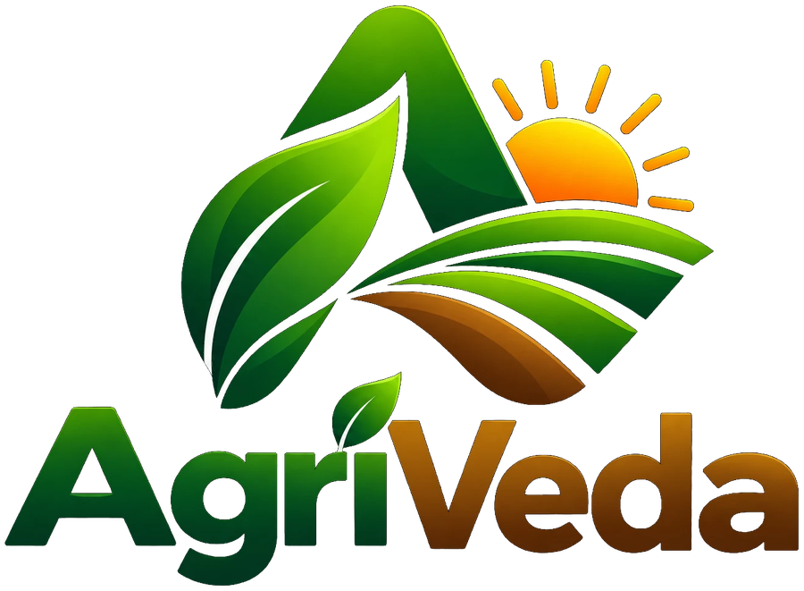

# Farmora — The Next Era of Precision Agriculture

<p align="center">
  
</p>

<p align="center">
  <strong>An AI-powered Precision Agriculture Portal delivering intelligent crop recommendations, real-time market rates, soil diagnostics, and predictive farming analytics.</strong>
</p>

<p align="center">
  
  
  
  
  <a href="https://farmora-the-next-era-of-precision-a.vercel.app/" target="_blank"></a>
</p>

---

## 🌾 Overview

**Farmora** is an end-to-end intelligent agricultural decision-support ecosystem designed to empower farmers with data-driven insights. By combining machine learning models with regional soil data, real-time weather metrics, and APMC market intelligence, Farmora helps farmers optimize planting decisions, reduce risk, and maximize profits.

---

## ✨ Key Features

### 🌟 1. Animated Landing & Visual Storytelling
* **Hero Experience:** Dynamic background video with motion effects and scroll-linked chapters.
* **Interactive Live Previews:** Explore crop suitability, market prices, and soil indicators without login.
* **Bilingual Interface:** Full localization in **English** and **Kannada (ಕನ್ನಡ)** with numeral and text transliteration.

### 🧠 2. AI-Driven Crop Recommendation Engine
* Evaluates soil pH, temperature, humidity, and rainfall to recommend high-yield crop varieties.
* Match highlights and detailed variety profiles (duration, yield per acre, sowing season, expected profit).

### 📈 3. APMC Market Intelligence & Forecasting
* Live mandi commodity price tracking with trend indicators (`up`, `down`, `stable`).
* 5-year historical price trend analysis and profit estimation calculator based on land acreage.

### 🧪 4. Soil & Climate Diagnostics
* Integration with soil datasets and SoilGrids estimates (organic carbon, nitrogen, CEC, sand/silt/clay fractions).
* Real-time localized weather telemetry (temperature, humidity, precipitation).

### 👥 5. Regional Neighbor & Land Analytics
* Spatial overview of neighboring plots and taluk/hobli crop distribution.
* Farmer history tracking and season-by-season yield record keeping.

---

## 🏗️ Architecture

```
Farmora/
├── main.py                     # FastAPI backend application & API endpoints
├── crop_varieties_data.py      # Detailed crop species & variety catalog
├── constants.py                # Regional constants and reference data
├── farmer_portal.db            # SQLite database for farmer profiles and records
├── test_farmer_portal.py       # Backend pytest test suite
│
└── frontend/                   # React + TypeScript + Vite SPA
    ├── index.html              # Entry HTML with Farmora brand favicon
    ├── vercel.json             # Vercel deployment configuration
    ├── package.json            # Frontend dependencies
    └── src/
        ├── App.tsx             # Main portal application logic & routing
        ├── components/
        │   ├── Brand.tsx       # Farmora brand lockup & wordmark
        │   └── Landing/        # Animated landing page chapters
        │       ├── HeroSection.tsx
        │       ├── ChallengesAndFeatures.tsx
        │       ├── InteractivePreviewSection.tsx
        │       ├── MarketAndProfitSection.tsx
        │       ├── RegionalAndPreviewSection.tsx
        │       ├── FAQSection.tsx
        │       ├── FinalCTAAndFooter.tsx
        │       └── landing.css
        ├── assets/
        │   ├── brand/          # Farmora logo and mark assets
        │   └── video/          # Hero background video
        ├── data/
        │   ├── locations.ts    # States, districts, taluks & hoblis
        │   └── translations.ts # English & Kannada localization
        └── types/              # Shared TypeScript interfaces
```

---

## 🚀 Getting Started

### Prerequisites
* **Node.js** (v18 or higher)
* **Python** (v3.10 or v3.11)
* **Git**

---

### 1. Backend Setup

1. Open your terminal in the root directory:
   ```bash
   cd "Farmer Portal"
   ```

2. Create and activate a Python virtual environment:
   ```bash
   # Windows PowerShell
   python -m venv .venv
   .\.venv\Scripts\Activate.ps1

   # Linux / macOS
   python3 -m venv .venv
   source .venv/bin/activate
   ```

3. Install backend dependencies:
   ```bash
   pip install fastapi uvicorn requests python-dotenv pydantic pytest
   ```

4. Start the backend server:
   ```bash
   python -m uvicorn main:app --reload --port 8000
   ```
   The API will be live at `http://localhost:8000` (Swagger docs at `http://localhost:8000/docs`).

---

### 2. Frontend Setup

1. Navigate to the `frontend` directory:
   ```bash
   cd frontend
   ```

2. Install dependencies:
   ```bash
   npm install
   ```

3. Start the Vite development server:
   ```bash
   npm run dev
   ```
   Open `http://localhost:5173` in your browser.

4. Build for production:
   ```bash
   npm run build
   ```

---

## 🌐 Live Deployment

Farmora is deployed and live on Vercel:

🔗 **[https://farmora-the-next-era-of-precision-a.vercel.app/](https://farmora-the-next-era-of-precision-a.vercel.app/)**

* **Hosting:** Vercel (CI/CD linked directly to the `main` branch)
* **Framework:** React 19 + TypeScript + Vite
* **Live Features:** Animated landing experience, interactive previews, capability strip, and bilingual English / Kannada interface.

---

## 🛡️ License

This project is licensed under the MIT License — see the LICENSE file for details.

